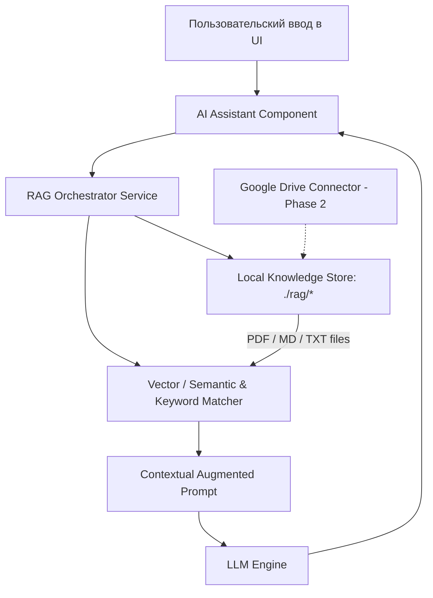

# Technical Specification (spec.md)

## 1. Архитектура и стек технологий

### 1.1. Frontend
- **Базовый фреймворк**: React 18 / Vite + TypeScript.
- **Стилизация**: Tailwind CSS (или Vanilla CSS design tokens) с жесткой палитрой под референс:
  - Deep Black Base: `#08080a`, `#0e0d11`, `#141318`
  - Accent Crimson / Dark Red: `#8B001D`, `#A5102A`, `#D11A38`
  - Contrast White: `#FFFFFF`, `#F4F4F5`
  - Muted Slate: `#8E8E93`, `#3F3F46`
- **Типографика**: Акцидентный геометрический гротеск (Cabinet Grotesk / Syne / Space Grotesk / Inter Display) для гигантских заголовков ("EMBE" / "ACADEMY") и читаемый гротеск для текста.
- **Анимации и физика**: Framer Motion / Motion (`motion/react`) с физикой пружин и контролем `useReducedMotion`.
- **Иконки**: `@phosphor-icons/react` или `@radix-ui/react-icons`.

### 1.2. RAG & AI Assistant Architecture


- **Папка `rag/`**: Хранилище локальных методичек, учебных планов и FAQ.
- **Парсер и индексатор**:
  - Чтение файлов `.md`, `.txt`, `.json`, `.pdf`.
  - Разбивка на чанки (Chunk size: 500-1000 символов с overlap 100).
  - Локальный семантический и ключевой поиск (BM25 / Cosine similarity) с быстрым кешированием.
- **Интерфейс Google Drive (Roadmap)**:
  - Абстракция `KnowledgeProvider`:
    ```ts
    interface KnowledgeProvider {
      id: string;
      sync(): Promise<SyncResult>;
      search(query: string, limit?: number): Promise<Chunk[]>;
    }
    class LocalFolderProvider implements KnowledgeProvider { ... }
    class GoogleDriveProvider implements KnowledgeProvider { ... }
    ```

---

## 2. Иерархия компонентов интерфейса

1. `App`
   - `Navbar`: Логотип, навигационные ссылки, быстрый доступ к поиску, кнопка запуска AI-тьютора.
   - `HeroSection`:
     - Фоновый слой с гигантской типографикой.
     - Центральный визуальный арт (человек в очках с книгой с атмосферным светом).
     - Плавающие карточки статистики:
       - `StatBadge`: "50+ Courses Crafted"
       - `StatBadge`: "200M+ Minutes Studied"
       - `DiscoverButton`: Акцентная круглая/пилюльная кнопка со стрелкой
     - Правый инфо-блок с лаконичным слоганом.
   - `ManifestoSection`:
     - Крупноформатный акцентный манифест.
     - Тег `[About us]` / `[Academy]`.
   - `DirectionsGrid` (Сетка категорий по референсу):
     - Карточки с аутентичным силуэтом (одна залитая бордовая "Active", остальные белые контрастные).
   - `CourseCatalog`:
     - Интерактивная фильтрация по уровню и стеку.
     - Детальный просмотр модулей и результатов обучения.
   - `AiTutorDrawer`:
     - Выдвижной или всплывающий диалог с поиском по базе `rag/`.
     - Предустановленные быстрые вопросы ("Расскажи о курсе UI/UX", "Как проходит защита диплома?").
     - Прозрачное цитирование фрагментов документов.
   - `Footer`: Фирменные копирайты, ссылки на контакты, соцсети.

---

## 3. Критерии качества и безопасности (Taste & Karpathy Compliance)
1. **Никакого визуального мусора**: Запрещены шаблонные фиолетовые AI-свечения, необоснованные градиенты и одинаковые карточки.
2. **Точность композиции**: Высота Hero `min-h-[100dvh]`, отсутствие паразитного скролла, адаптивность для мобильных и десктопных экранов.
3. **Хирургическая чистота кода**: Четкая модульность, отсутствие мертвого кода и избыточных оберток.
